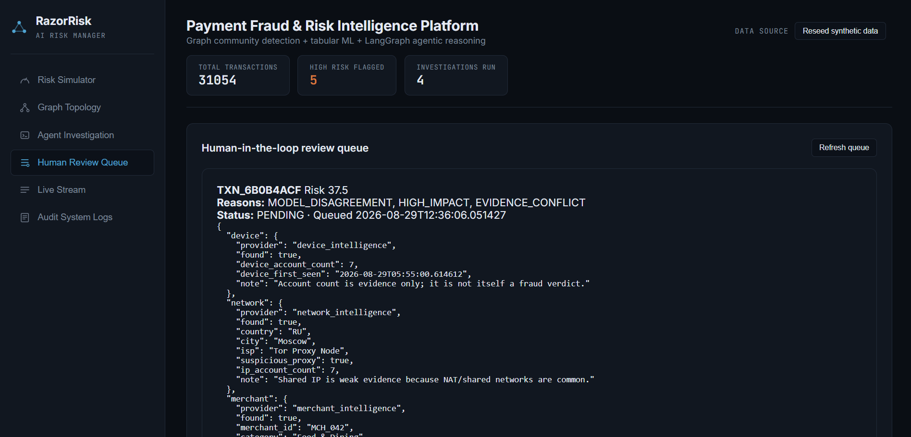
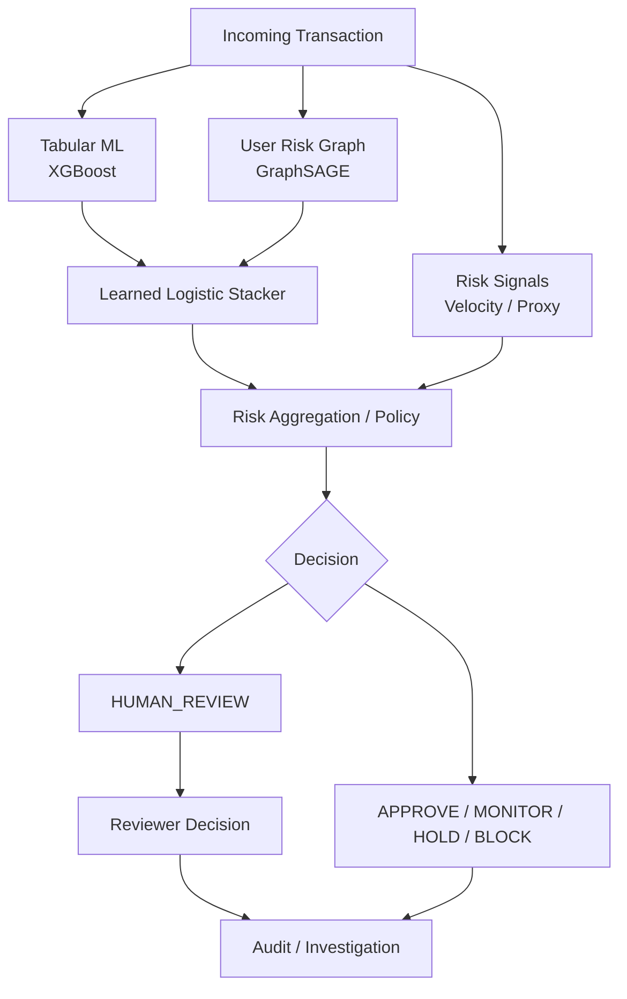
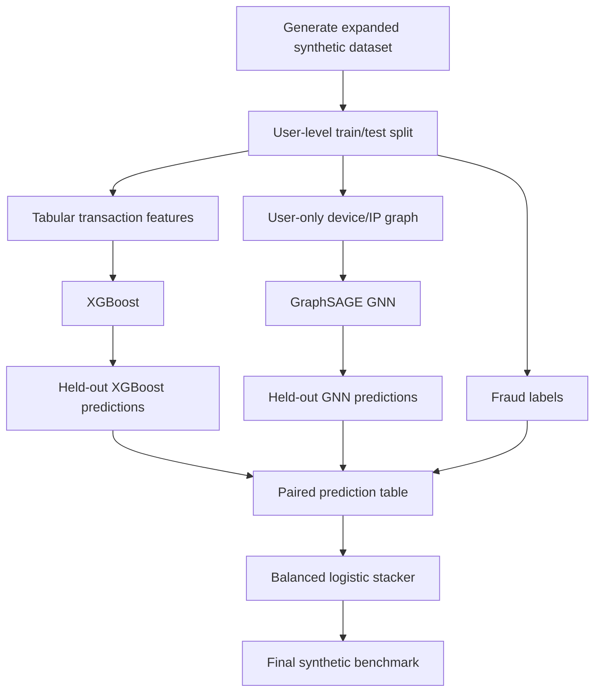

# RazorRisk — Agentic AI Payment Fraud & Risk Investigation Platform

[**Live demo**](https://razorrisk-agentic-ai-payment-fraud-risk.antideploy.com/dashboard/) · [**Demo video**](https://drive.google.com/file/d/1pactgyj_zuM1nKsdecU7-bIHsfQ-psuq/view?usp=drive_link)

> A production-inspired AI risk prototype combining transaction-level ML, graph-based fraud-community signals, calibrated score fusion, security guardrails, human-in-the-loop (HITL) investigation, and an optional independent verification layer.

A transaction can look normal in isolation while its user is linked to risky users through shared devices or IPs. RazorRisk therefore fuses **tabular transaction evidence** with **relational graph evidence**, then passes the result through an explicit risk policy and investigation workflow. It demonstrates the engineering behind an AI Risk Manager system: model decomposition, stateful features, graph reasoning, calibration, deterministic guardrails, HITL escalation, auditability, and regression testing.

---

## Highlights

- **Learned score fusion** — a logistic-regression stacker combines the XGBoost score, the GNN score, and normalized shared-device/shared-IP counts, replacing a hand-picked `0.35/0.45/0.20` formula.
- **GraphSAGE from scratch in NumPy** — 2-layer mean aggregation with manual forward/backward passes and inductive inference for brand-new users.
- **Two graphs, on purpose** — a User-only risk graph feeds the GNN and community detection; a richer User/Device/IP/Merchant graph is for visualization only. Merging them once turned a 7-person ring into a 692-node subgraph through one popular merchant.
- **Real HITL workflow** — `HUMAN_REVIEW` creates a persisted, idempotent queue record with a `review_id`, not just a UI label.
- **Audited velocity source** — a toggle chooses client-supplied velocity (simulation) or backend-computed velocity (production); the source is recorded on every transaction.
- **Dual-mode investigation agent** — Anthropic / Groq / OpenAI when configured, with a full deterministic fallback. Every report records which mode ran.
- **Evidence-grounded investigations** — four deterministic tools (`GraphTool`, `TransactionHistoryTool`, `DeviceRiskTool`, `FraudModelTool`) compute the evidence; the LLM only interprets it.
- **Golden adversarial test matrix** — named fraud-ring and benign look-alike scenarios (hostel Wi-Fi, carrier NAT, festival sales), with known gaps disclosed by name.
- **Published bug history** — 40 verified engineering bugs documented in [BUGS.md](BUGS.md).

<p>
  
  
  
</p>

*Left to right: Risk Simulator (score decomposition + graph evidence), Graph Topology (7-user ring on one device/IP), Human Review Queue (reasons, evidence, Approve/Hold/Block). More views in `images/`.*

---

## Architecture

**Core principle: models generate evidence; policy determines the action.** No single model score becomes an unexplained block/approve decision.



| Layer | Responsibility |
| --- | --- |
| **Tabular ML (XGBoost)** | Transaction-level behavioral patterns |
| **GNN (GraphSAGE)** | Relational / community context |
| **Stacker** | Learned combination of model evidence |
| **Policy + guardrails** | Operational decision and escalation |
| **HITL** | Human resolution of ambiguous or high-impact cases |
| **Investigation agent** | Evidence gathering and explanation |
| **Audit layer** | Traceability via correlation IDs |

### Decision policy

- **Mandatory-human reasons** (model disagreement, evidence conflict, uncertainty, high-impact amount) → always `HUMAN_REVIEW`, however confident the score.
- Otherwise, stacker confidence **≥ 0.95** → automatic `BLOCK`.
- Otherwise the risk tier decides: `LOW` → APPROVE, `MEDIUM` → MONITOR, `HIGH` → HOLD_FOR_INVESTIGATION, `CRITICAL` → BLOCK_PENDING_REVIEW.

### Key design details

- **Stateful velocity:** in backend mode, hourly velocity is counted from transaction history (a client-supplied velocity is not a secure fraud signal). The source (`CLIENT` / `BACKEND`) is persisted and audited.
- **Causal graph update:** a transaction never influences its own GNN score. It is scored against the graph *before* it is persisted, then the graph snapshot is invalidated.
- **Optional Jev verification (opt-in, off by default):** after the investigator produces a hypothesis, Jev independently picks an action and checks that the hypothesis is grounded in the evidence. It is outside the scoring path and fails open. It can auto-triage a pending review only at confidence ≥ 0.85 and never when a mandatory-human reason exists.
- **Audit decomposition:** every transaction logs tabular score, GNN score, stacker score, final 0–100 score, velocity + source, policy decision, HITL state, and correlation ID.
- **Latency (measured, local dev):** full scoring is ~18–20 ms p50, nearly all of it XGBoost feature build + inference; the GNN reads a cached graph snapshot (~0.2 ms). Reproduce with `python tests/benchmark_scoring.py`.

---

## Evaluation

Everything is trained and evaluated on **one synthetic RazorRisk dataset** with a shared user-level train/test split. XGBoost sees transaction features, the GNN sees the User-only device/IP graph, and the stacker is trained on their paired held-out predictions. The public ULB/Kaggle `creditcard.csv` is **not** used: its PCA features and missing User/Device/IP/Merchant identities don't match this domain.

### Model training and evaluation pipeline

The same generated population supplies the tabular view, the User-only graph view, and the labels, so the models learn *different evidence from the same transactions* rather than being compared across incompatible datasets.



The generator targets scenario **coverage**, not row count: graph-driven fraud rings, transaction-only fraud, low-observability fraud (cold-start, account takeover, low-and-slow), and hard benign look-alikes (family/hostel sharing, carrier NAT, event spikes, bill splitting).

**Held-out pool: 9,218 transactions (78 fraud).** Reproduce with `python tests/evaluate_models.py --dataset synthetic` (add `--retrain` to retrain).

| Model | ROC-AUC | PR-AUC | Precision | Recall | F1 |
| --- | --- | --- | --- | --- | --- |
| Tabular / XGBoost | 0.9981 | 0.9551 | 0.7115 | 0.9487 | 0.8132 |
| GraphSAGE / GNN | 0.9959 | 0.8881 | 0.3763 | 0.8974 | 0.5303 |
| **Learned stacker** | **0.9984** | **0.9561** | **0.7872** | **0.9487** | **0.8605** |

Final stacker confusion matrix: **74 TP / 20 FP / 4 FN / 9,120 TN**. At matched recall, the GNN alone throws 116 false positives against the stacker's 20.

With fraud under 1% of the data, **accuracy and ROC-AUC look excellent for almost any model**, so decisions rest on precision, recall, and PR-AUC.

**Training choices:** the stacker uses `class_weight="balanced"` (`C=0.05`); XGBoost uses `scale_pos_weight`; GraphSAGE uses a positive-class loss weight. Hyperparameters were selected by user-level 3-fold CV on PR-AUC (`ml/hyperparameter_search.py`) and are consumed by the training pipeline via `ml/models/hyperparameters.json`.

**Aggregate metrics don't guarantee every hard scenario clears the live threshold.** The golden matrix is a separate blocking regression suite: `USER_RING1_1` (device ring) must reach HIGH/CRITICAL and `USER_RING2_1` (shared-IP proxy ring) MEDIUM or higher.

### What this does *not* demonstrate

- Production-level fraud recall.
- That the GNN generalizes to real payment networks.
- That any threshold or auto-block cutoff is optimal for a real business cost function. All were tuned on synthetic data.
- That an LLM investigation report is itself a fraud classifier.

---

## Engineering bugs discovered and fixed

The project grew through repeated end-to-end testing. Full write-ups for all 40 bugs are in [BUGS.md](BUGS.md). The most structurally significant:

| # | Bug | One line |
| --- | --- | --- |
| 1 | Fraud-ring graph explosion | A 2-hop traversal via a shared Merchant turned a 7-person ring into a 692-node subgraph |
| 4 | Hand-picked score fusion | Replaced a fixed formula with a logistic stacker trained on held-out data |
| 18 | Connectivity alone scored as fraud | `shared_ip >= 5` flagged a 40-person carrier-NAT IP and a 7-person hostel |
| 21 | Velocity trusted from the client | Three modules read client velocity independently instead of one server-computed value |
| 29 | Time-of-day features used server clock | Re-scoring the same transaction returned tabular scores from 2.7% to 99.4% |
| 30 | New user's first transaction could never auto-block | A hardcoded `0.0` GNN placeholder was read as a confident "not fraud" vote |

---

## Testing and CI/CD

`pytest -q` covers fraud scenarios, benign look-alikes, graph behavior, velocity modes, decision policy, HITL creation/idempotency/resolution, evaluation contracts, API behavior, and Jev verification safety. **Latest verified: 98 passed.**

GitHub Actions runs the full test suite, compiles the packages, and builds the Docker image (gated on green tests). On trusted `main` pushes it also runs a live Supabase PostgreSQL smoke test (credentials are repository secrets). CD publishes the image to GHCR with `latest` and commit-SHA tags; it does not deploy to a server.

---

## Tech Stack

| Layer | Technology |
| --- | --- |
| API | FastAPI, Uvicorn, Pydantic |
| Database | PostgreSQL / Supabase (`psycopg`); SQLite only as test/local fallback |
| ML | XGBoost, scikit-learn (stacker), NumPy GraphSAGE |
| Graph | NetworkX + Louvain |
| Agent | LangChain / LangGraph; Anthropic / Groq / OpenAI (optional); deterministic fallback |
| Queue / limits | Redis Streams, Lua sliding-window rate limiter |
| Observability | Prometheus, Grafana, OpenTelemetry, 8-channel correlation-ID audit logs |
| Frontend | Vanilla HTML/CSS/JS, vis-network, marked.js |
| Deployment | Docker Compose, Render, Antideploy, Hugging Face Spaces, Vercel (static dashboard) |

### Production runtime

API replicas and investigation workers scale independently. Redis provides atomic shared rate limiting (`429` with `Retry-After`) and a durable investigation queue (`POST /api/v1/investigations/enqueue/{id}` returns `202` with a job ID; stale jobs are reclaimed and retried within an SLA). PostgreSQL/Supabase is the shared source of truth for transactions, risk scores, HITL state, and investigations. Set `REDIS_REQUIRED=true` in production. The backend (~2 GB of dependencies) cannot run as a Vercel function, so only the static dashboard goes there.

Prometheus exposes request rate, errors, latency, score/decision distribution, queue depth, retries, and rate-limit hits. These are operational signals, **not** automatic drift detection.

---

## Quick Start

**A) Docker (recommended)** — starts Postgres, Redis, the API, and the investigation worker:

```bash
docker compose up --build
```

**B) Manual, no Docker (SQLite):**

```bash
git clone https://github.com/Dikshu015/RazorRisk-Agentic-AI-Payment-Fraud-Risk-Investigation-Platform.git
cd RazorRisk-Agentic-AI-Payment-Fraud-Risk-Investigation-Platform
python -m venv .venv && source .venv/bin/activate   # Windows: .\.venv\Scripts\Activate.ps1
pip install -r requirements.txt
cp .env.example .env                                # then set DATABASE_URL=sqlite:///./razor_risk.db
python data/generate_synthetic_data.py
python ml/train_tabular_model.py && python ml/train_gnn.py
python run.py
```

Without Redis, rate limiting fails open and investigations run synchronously in-process. Open `http://localhost:8000/dashboard/` (API docs at `/docs`).

**Suggested demo flow:** normal transaction (low risk, auto-approve) → high-value transaction (HITL escalation) → fraud-ring transaction (GNN + graph topology) → transaction history (score decomposition) → resolve a HITL case → run an investigation → trace it in audit logs via correlation ID → `pytest -q`.

---

## Repository Structure

`agent/` investigation agent · `api/` FastAPI routes · `ml/` XGBoost, GNN, stacker, policy, model artifacts · `data/` synthetic generator · `db/` schema + dual-dialect access layer · `infra/` Redis, rate limiter, workers, observability · `security/` evidence-tool guardrails · `static/` dashboard · `tests/` unit/regression/golden-matrix suites · `docs/` Mermaid sources · `grafana/` dashboards · `BUGS.md` bug history

---

## API Reference (key endpoints)

| Endpoint | Method | Purpose |
| --- | --- | --- |
| `/api/v1/transactions/score` | POST | Score a transaction (tabular + GNN + stacker + overlays) |
| `/api/v1/transactions/recent` | GET | Recent transaction feed |
| `/api/v1/graph/topology/{user_id}` | GET | Bounded User/Device/IP/Merchant view |
| `/api/v1/investigations/run/{id}` | POST | Run the investigation agent |
| `/api/v1/investigations/enqueue/{id}` | POST | Queue an async investigation (`202` + job ID) |
| `/api/v1/investigations/jev-mode` | POST | Toggle optional Jev verification |
| `/api/v1/hitl/queue` | GET | Pending human reviews |
| `/api/v1/hitl/review/{review_id}` | POST | Resolve a review (`APPROVE` / `HOLD` / `BLOCK`) |
| `/api/v1/logs/stream` | GET | Stream the 8 audit/system log channels |