# RazorRisk — Agentic AI Payment Fraud & Risk Investigation Platform

[**Demo video**](https://drive.google.com/file/d/1pactgyj_zuM1nKsdecU7-bIHsfQ-psuq/view?usp=drive_link)

> **A production-inspired AI risk prototype that combines transaction-level machine learning, graph-based fraud-community signals, calibrated score fusion, security guardrails, human-in-the-loop investigation, and an independent Jev (TypeSafe System One) verification layer.**

RazorRisk treats payment fraud as more than a row-level classification problem. A transaction can look normal in isolation while its user is connected to other risky users through shared devices or IP addresses. The platform therefore combines **tabular transaction evidence** with **relational graph evidence**, then passes the result through an explicit risk-policy and investigation workflow.

The project is designed to demonstrate the engineering decisions behind an AI Risk Manager system: model decomposition, stateful features, graph reasoning, calibration, deterministic guardrails, HITL escalation, auditability, reproducible evaluation, and regression testing.

---

## Table of Contents

- [Highlights](#highlights)
- [Live Demo / Screenshots](#live-demo--screenshots)
- [Why RazorRisk?](#why-razorrisk)
- [What the project demonstrates](#what-the-project-demonstrates)
  - [1. Transaction-level fraud detection](#1-transaction-level-fraud-detection)
  - [2. Graph-based fraud-community detection](#2-graph-based-fraud-community-detection)
  - [3. Learned score fusion](#3-learned-score-fusion)
  - [4. Stateful hourly velocity](#4-stateful-hourly-velocity)
  - [5. Security guardrails](#5-security-guardrails)
  - [6. Real human-in-the-loop workflow](#6-real-human-in-the-loop-workflow)
  - [7. Evidence-grounded investigation](#7-evidence-grounded-investigation)
  - [7.5. Optional Jev verification layer](#75-optional-jev-verification-layer)
  - [8. Auditable model decomposition](#8-auditable-model-decomposition)
- [End-to-end workflow](#end-to-end-workflow)
  - [Transaction flow](#transaction-flow--data-moving-through-the-system)
  - [System structure](#system-structure--how-components-connect-and-complement-each-other)
  - [Causal graph update](#causal-graph-update)
- [Why the architecture is stronger than a single fraud model](#why-the-architecture-is-stronger-than-a-single-fraud-model)
- [Evaluation](#evaluation)
  - [Latest reproducible synthetic run](#latest-reproducible-synthetic-run)
  - [Understanding these metrics](#understanding-these-metrics)
  - [Stacker effect](#stacker-effect)
  - [Expanded synthetic scenario coverage](#expanded-synthetic-scenario-coverage)
- [Hyperparameter Selection (CV)](#hyperparameter-selection-cv)
- [Current model/data contract](#current-modeldata-contract)
- [What the evaluation proves — and what it does not](#what-the-evaluation-proves--and-what-it-does-not)
- [Engineering bugs discovered and fixed](#engineering-bugs-discovered-and-fixed) — 40 numbered bugs across five phases; full write-ups in [BUGS.md](BUGS.md)
- [Testing](#testing)
- [CI/CD](#cicd)
- [Tech Stack](#tech-stack)
- [Deployment](#deployment)
  - [Production Distributed Runtime](#production-distributed-runtime)
  - [Production Data Plane — PostgreSQL / Supabase](#production-data-plane--postgresql--supabase)
  - [Production Observability — Metrics, Tracing & SLO Signals](#production-observability--metrics-tracing--slo-signals)
- [Quick Start](#quick-start)
- [Suggested Demo Flow](#suggested-demo-flow)
- [Repository Structure](#repository-structure)
- [API Reference](#api-reference)
- [How RazorRisk Mitigates Those Limitations](#how-razorrisk-mitigates-those-limitations)
- [Limitations and Defensible Scope](#limitations-and-defensible-scope)
- [FAQ](#faq)
- [References / Further Reading](#references--further-reading)
- [Status](#status)

---

## Highlights

- **Learned score fusion with graph evidence as a real input** — a logistic-regression stacker combines the tabular score, the GNN score, *and* normalized shared-device/shared-IP counts, instead of a fixed `0.35/0.45/0.20` formula or a hand-picked connectivity rule bolted on afterward (see Bug 18 for why the rule version was retired).
- **GraphSAGE GNN written from scratch in NumPy** — a 2-layer mean-aggregation implementation with manual forward/backward passes and a genuine inductive inference path for brand-new users, kept dependency-light at this project's ~1,500-node scale.
- **Two graphs, on purpose** — a canonical User-only risk graph feeds the GNN and community detection; a richer User/Device/IP/Merchant graph powers dashboard visualization only. They are split because merging them once turned a 7-person fraud ring into a 692-node subgraph through one popular merchant (Bug 1).
- **Real human-in-the-loop workflow** — `HUMAN_REVIEW` creates an actual persisted, idempotent queue record with a `review_id`, not just a UI label (Bug 16).
- **Explicit, audited velocity source** — a frontend toggle chooses between trusting client-supplied velocity (simulation) and backend-computed velocity from transaction history (production-oriented); the effective source is recorded on every transaction (Bugs 14, 15, 21).
- **Dual-mode investigation agent** — Anthropic / Groq / OpenAI when configured, with a complete deterministic rule-based fallback when no provider is available or a call fails. Every report records which mode actually ran.
- **Evidence-grounded investigation** — four deterministic tools (`GraphTool`, `TransactionHistoryTool`, `DeviceRiskTool`, `FraudModelTool`) compute the underlying evidence; an LLM, when available, interprets it rather than inventing it.
- **Optional independent verification (Jev)** — an opt-in post-investigation check of the recommended action and the hypothesis grounding, kept outside the scoring hot path and fail-open, with retries, a circuit breaker, and guarded auto-triage that can never bypass mandatory-human reasons.
- **One coherent synthetic evaluation domain** — both XGBoost and GraphSAGE are trained and evaluated from the same RazorRisk synthetic transaction population, using complementary transaction-level and relational feature sets; the learned stacker is trained on paired predictions from those same transactions.
- **A golden adversarial test matrix** — `tests/GOLDEN_TEST_MATRIX.md` checks the trained model against dozens of named fraud-ring and benign-look-alike scenarios (hostel Wi-Fi, carrier-NAT, festival sales, family devices). It runs as a blocking regression suite in CI, and the assertions were fixed at the source (Bugs 39–40) rather than weakened.
- **A published bug history, not just a feature list** — 40 concrete, verified engineering bugs with what broke, how it was found, and why the fix is defensible — see the [Engineering bugs](#engineering-bugs-discovered-and-fixed) section and [PROJECT_WORKFLOW.md](PROJECT_WORKFLOW.md).
- **One shared production data layer** — PostgreSQL/Supabase is the production source of truth for transactions, risk scores, HITL state, and investigations; SQLite is retained only as an explicit test/local fallback.

---

## Live Demo / Screenshots

| | |
| --- | --- |
| **1. Risk Simulator** — the live payment-risk evaluator: preset one-click scenarios (`Normal txn`, `Fraud ring #1 (device)`, `Fraud ring #2 (proxy IP)`, `Carding attack`), the velocity-source toggle, and the composite risk panel showing the tabular/GNN/stacker score decomposition plus instant graph evidence (shared devices, shared IPs, community size) for the submitted transaction | 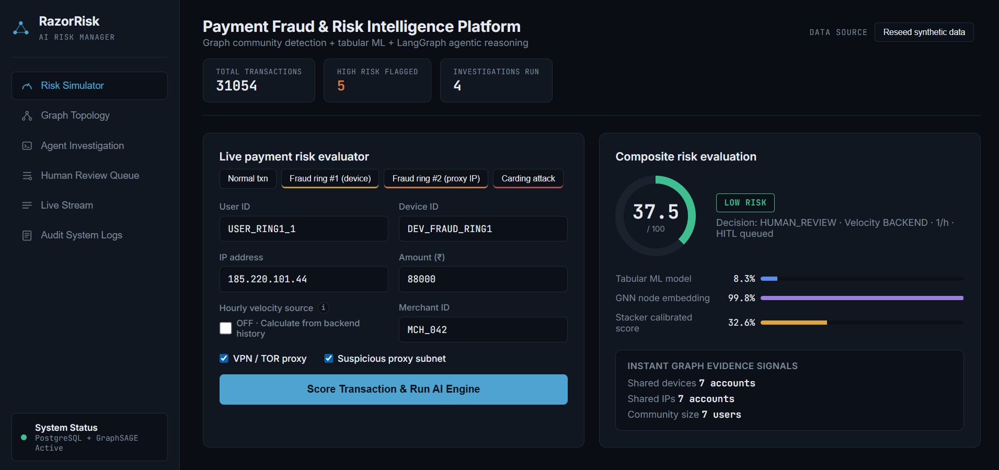 |
| **2. Graph Topology** — the interactive User↔Device↔IP↔Merchant network view for the same scenario: a 7-user fraud ring (`USER_RING1_1`…`_7`) converging on one shared device and IP, with two merchants shown as context nodes | 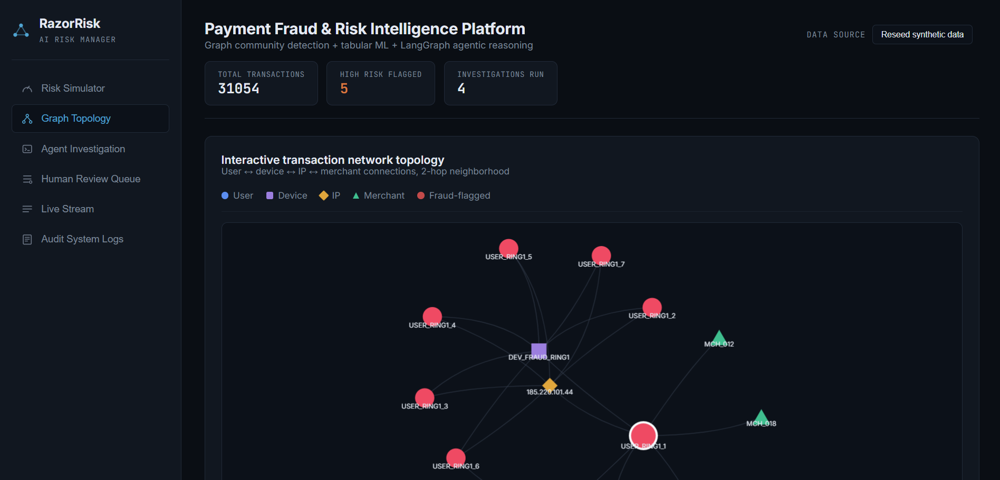 |
| **3. Agent Investigation** — a live Groq-backed LangGraph investigation report: evidence breakdown (graph, device/connection risk, transaction velocity, ML model signals), the fraud hypothesis and reasoning, and the recommended action (`BLOCK_ACCOUNT_AND_HOLD_FUNDS`) with its rationale | 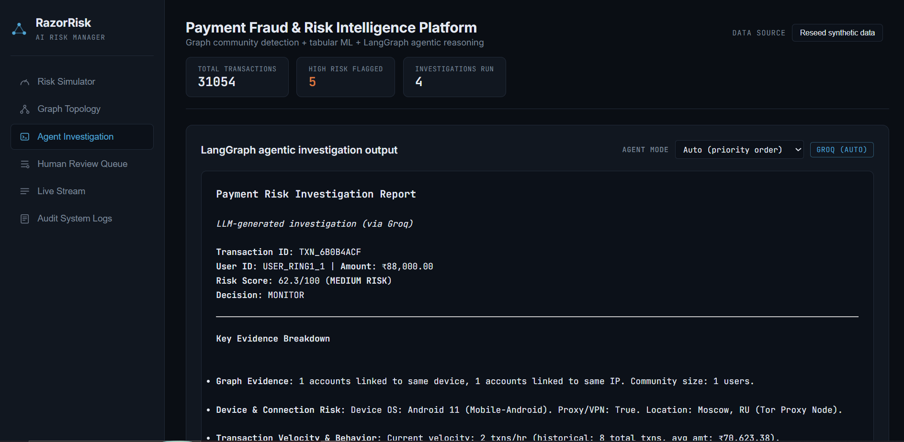 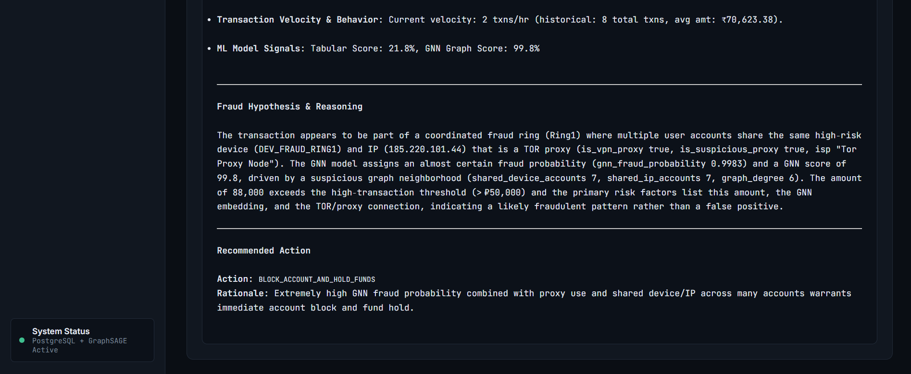 |
| **4. Human Review Queue** — a persisted, real `HUMAN_REVIEW` case: the queued reasons (`MODEL_DISAGREEMENT`, `HIGH_IMPACT`, `EVIDENCE_CONFLICT`), the structured device/network/merchant evidence gathered for the reviewer, and the actual Approve / Hold / Block controls a reviewer would use to resolve it |  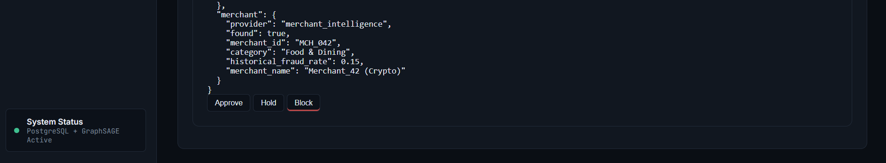 |
| **5. Live Stream** — the recent-transactions table, scrolled to show both the raw transaction fields (user/device/IP/amount/velocity) and the full score decomposition (GNN, tabular, stacker-calibrated, final risk score, tier, action) side by side per row | 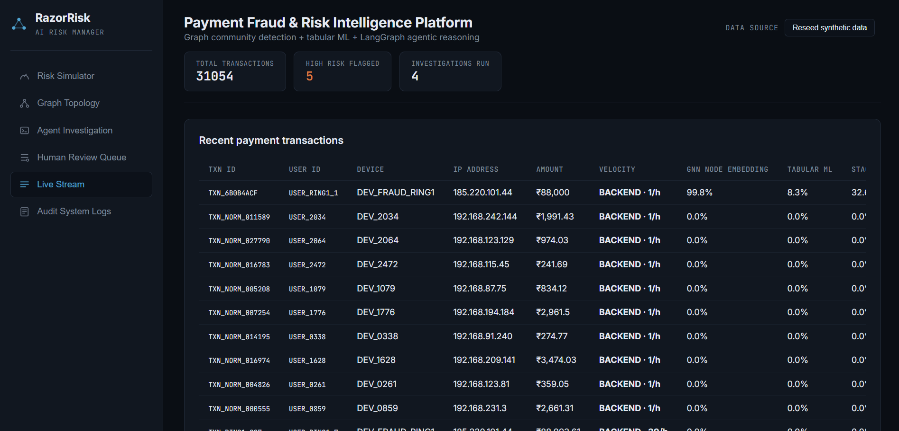 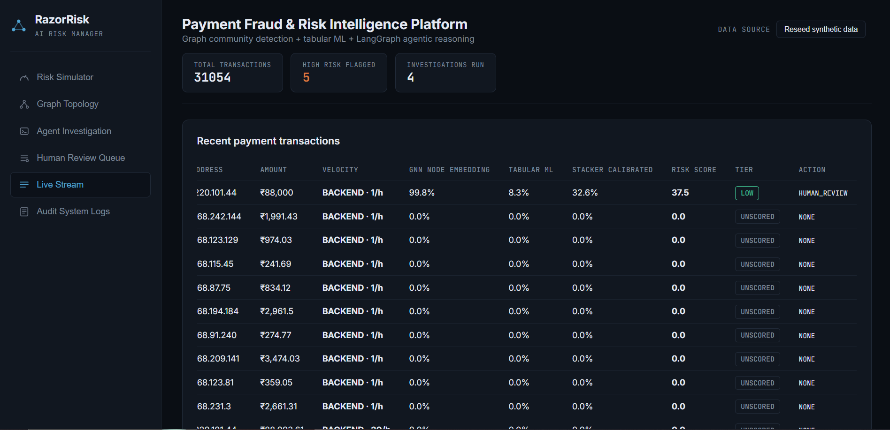 |
| **6. Audit System Logs** — the risk-engine and agent-investigation log channels side by side, correlation-ID-traceable, showing a real transaction's full score trail and a real Groq LLM investigation dispatch/completion pair | 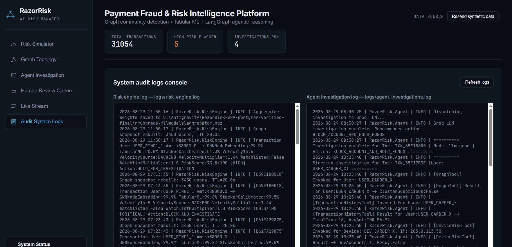 |

Screenshots reflect the actual seeded dataset and a live LLM call where noted. The six views follow the dashboard's own left-hand navigation order (Risk Simulator → Graph Topology → Agent Investigation → Human Review Queue → Live Stream → Audit System Logs). See [Suggested Demo Flow](#suggested-demo-flow) for a walkthrough script that visits the same pages in a task-driven order, and the [Evaluation](#evaluation) section for what the risk scores shown do and don't claim.

---

## Why RazorRisk?

A conventional fraud classifier looks like:

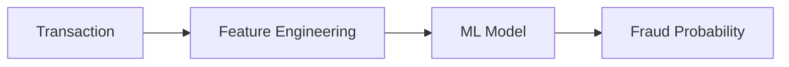

That is useful, but coordinated fraud can be relational:

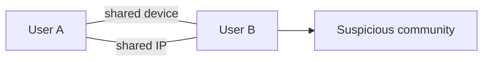

RazorRisk adds graph context without making the graph model the sole decision-maker.

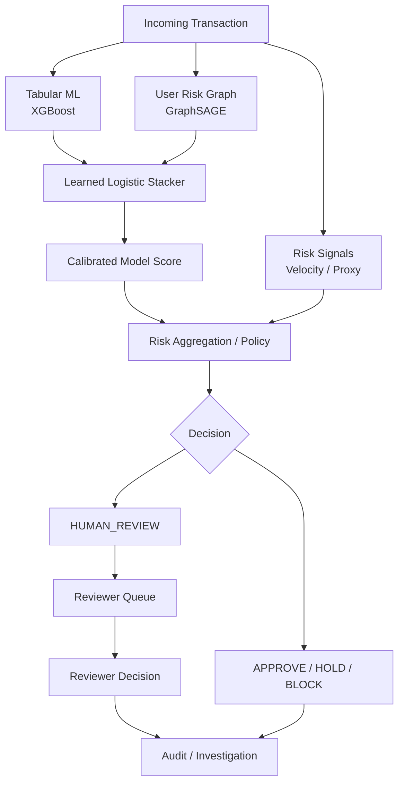

### Core design principle

**Models generate evidence; policy determines the operational action.**

This separation prevents a single model score from becoming an unexplained block/approve decision.

### Model training and evaluation pipeline

The current benchmark is deliberately **synthetic-only**. The same generated transaction population supplies the tabular feature view, the User-only graph view, and the labels used to train and evaluate the stacker. The models therefore learn different evidence from the same underlying transactions rather than being compared across incompatible datasets.

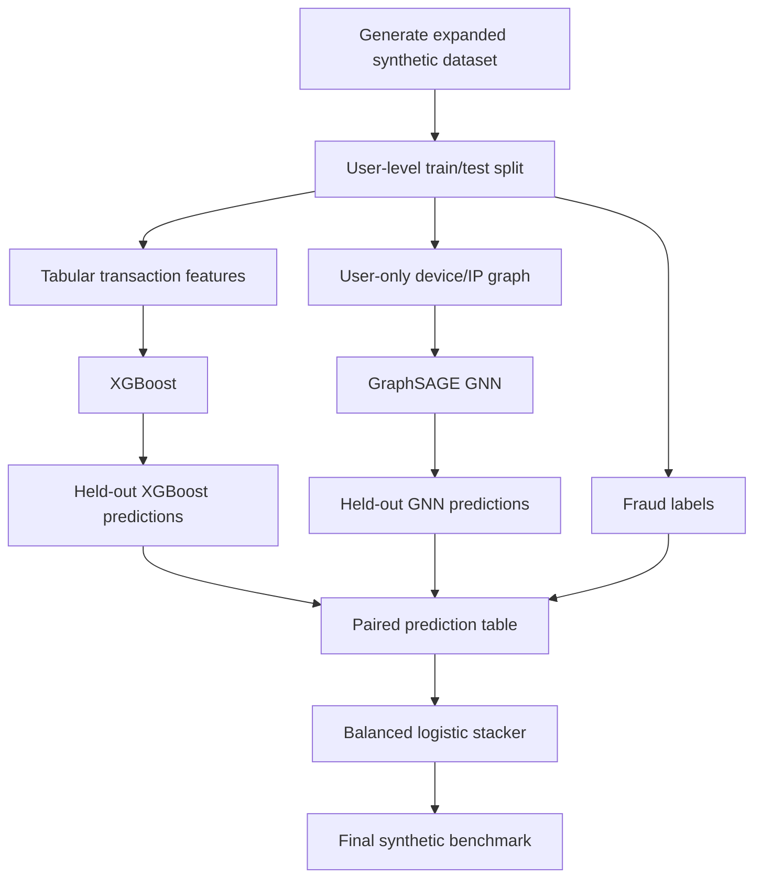

### Live transaction pipeline

A live transaction is evaluated by both complementary model branches before policy. XGBoost evaluates transaction-level behavior; the GNN evaluates the user's relational context; the stacker learns how to combine those signals. Velocity, VPN/proxy indicators, guardrails, and HITL remain explicit downstream controls.

Per-stage timings below are **measured, not estimated**: `time.perf_counter()` around each real function, p50 of 30 warm calls, local dev container, SQLite backend, 1,750-node cached graph snapshot. Reproduce with `python tests/benchmark_scoring.py`. Treat these as *relative cost between stages*, not a production SLA: no concurrency, no network hop to a real Postgres/Redis, and whatever CPU happens to run the benchmark.

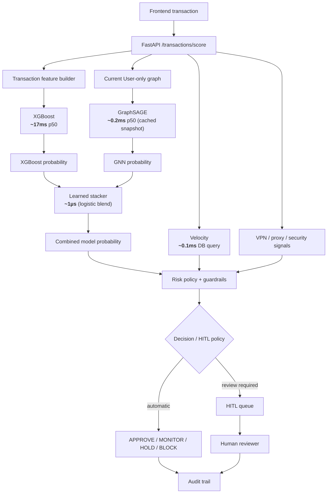

**Where the time actually goes:** the full `calculate_composite_risk_score()` call measures **~18–20 ms p50** warm, and XGBoost's feature build plus `predict_proba` accounts for essentially all of it (~16–17 ms). The GNN, velocity query, and stacker blend are each under a millisecond because they read a cached graph snapshot and a small SQLite row instead of doing new heavy computation per request. The snapshot itself is what's expensive, and that cost is paid periodically (**~50–55 ms** to rebuild and re-run community detection over 1,750 users / 2,731 edges), not on every transaction.

The measured full HTTP round-trip through the live FastAPI endpoint (uvicorn dev server, single process) is **~145–255 ms**. Request/response overhead, not model inference, is the larger share of what a client waits on. That gap is why [horizontal API/worker scaling](#production-distributed-runtime) targets replica count and queueing, not model latency, as the thing to scale. Exact numbers move run to run (background load, dataset size, cold caches); `python tests/benchmark_scoring.py` reproduces them on whatever is currently running.

---

## What the project demonstrates

### 1. Transaction-level fraud detection

An XGBoost classifier handles structured transaction and behavioral features. XGBoost is used because gradient-boosted trees are a strong baseline for structured/tabular data and can model nonlinear feature interactions efficiently. See the [official XGBoost documentation](https://xgboost.readthedocs.io/en/stable/).

### 2. Graph-based fraud-community detection

RazorRisk maintains a **User-only risk graph** where users can be connected through shared infrastructure such as devices and IP addresses. A GraphSAGE-style message-passing model produces node embeddings and a graph risk score.

The important design choice is that the graph is kept separate from the richer multi-entity application graph. This prevents investigation-oriented traversal through merchants from accidentally turning a small fraud community into an enormous GNN neighborhood.

Reference: [GraphSAGE — Inductive Representation Learning on Large Graphs](https://arxiv.org/abs/1706.02216).

### 3. Learned score fusion

The system does not simply average model scores or use arbitrary hand-written weights.

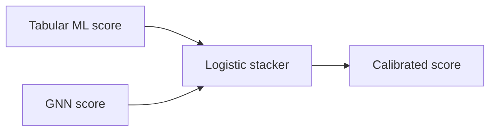

The stacker learns how the model signals relate on held-out data. The resulting calibrated score remains separate from deterministic risk overlays such as velocity and proxy signals.

### 4. Stateful hourly velocity

Velocity is derived from transaction history when backend mode is selected. The frontend exposes an explicit source toggle:

| Toggle | Behavior | Intended use |
| --- | --- | --- |
| **ON — Trust client value** | Uses supplied `velocity_1h` | Controlled simulation/testing or trusted upstream integration |
| **OFF — Calculate backend value** | Ignores client value and counts transactions in the trailing hour | Trustworthy production-oriented mode |

The selected source is persisted and audited as `CLIENT` or `BACKEND`.

This distinction matters because a client-controlled velocity field is not a secure fraud signal by itself.

### 5. Security guardrails

Model output is not the only source of risk. Explicit policy rules can escalate high-impact transactions, suspicious infrastructure, or model disagreements.

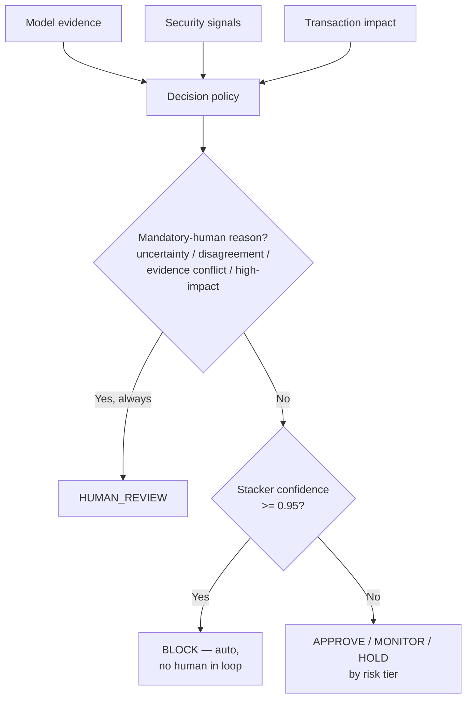

A confidence threshold alone never overrides the mandatory-human reasons. Model disagreement, evidence conflict, and high-dollar-amount transactions always keep a human in the loop regardless of how confident the score is (see [`ml/decision_policy.py`](ml/decision_policy.py)).

### 6. Real human-in-the-loop workflow

`HUMAN_REVIEW` is an actual persisted workflow, not merely a UI label.

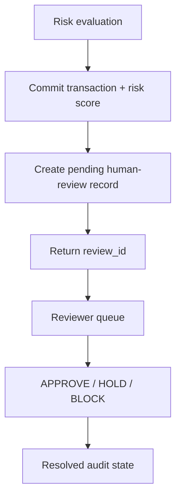

Queue creation is idempotent for already-pending transactions.

### 7. Evidence-grounded investigation

The investigation layer is separate from scoring. Deterministic tools collect structured evidence such as:

- graph relationships
- transaction history
- device risk
- model-score decomposition

An LLM, when configured, interprets this evidence instead of inventing the underlying risk measurements. A deterministic fallback is available when no external model provider is configured.

### 7.5. Optional Jev verification layer

RazorRisk can run an **opt-in Jev (TypeSafe System One) verification pass** after the investigation agent has produced its hypothesis and recommended action. Jev is deliberately outside the fraud-scoring hot path: the XGBoost + GraphSAGE + learned-stacker score is unchanged whether Jev is enabled or disabled.

The verification pass performs two independent checks over the deterministic evidence already gathered by the investigation agent:

1. **Independent action check** — Jev selects one action from the same five-action vocabulary used by the investigator without being shown the investigator's answer.
2. **Hypothesis-grounding check** — Jev checks whether the investigator's fraud hypothesis is supported by the supplied evidence rather than containing invented counts, IDs, or other specific claims.

The result is one of:

- `CONSISTENT` — the independent action agrees and the hypothesis grounding score clears the configured threshold.
- `REVIEW_RECOMMENDED` — the independent action disagrees or the hypothesis grounding check is below threshold.
- *no verification result* — Jev is disabled, unconfigured, or unavailable; the investigation still completes.

Jev is **not** the fraud detector and does not replace the investigator's action. When a pending HITL review exists, `CONSISTENT` is additionally eligible for automatic triage only when the independent action confidence is at least `JEV_AUTO_RESOLVE_MIN_CONFIDENCE` (default `0.85`) **and none of the mandatory-human reasons are present**. Mandatory-human reasons remain human-controlled regardless of model agreement.

The dashboard exposes a process-local **Jev verification** toggle. It is off by default and requires `TYPESAFE_API_KEY`. The toggle resets to off after a process restart. Configure optional settings in `.env`:

```
TYPESAFE_API_KEY=
TYPESAFE_API_BASE=https://api.typesafe.ai
TYPESAFE_MODEL=jev-latest
TYPESAFE_TIMEOUT_SECONDS=5
JEV_AUTO_RESOLVE_MIN_CONFIDENCE=0.85
```

Jev failures are fail-open for the investigation report: timeout, network, non-2xx, or malformed responses are logged and the report is returned without the Jev section. This keeps the verification layer from becoming a payment-decision dependency.

### 8. Auditable model decomposition

Transaction history and risk-engine logs expose:

- **Tabular ML score**
- **GNN node-embedding score**
- **Stacker calibrated score**
- final risk score
- velocity and its source
- policy decision
- HITL state
- correlation ID

This makes it possible to answer **why** a transaction received its final action rather than exposing only a single opaque number.

---

## End-to-end workflow

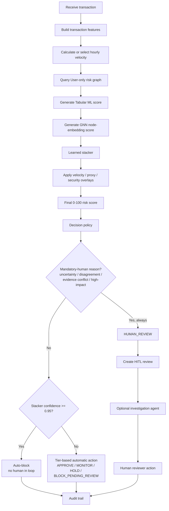

### Transaction flow — data moving through the system

The transaction path is intentionally shown as parallel signal branches that converge before policy evaluation. Each branch produces evidence; no single branch directly owns the final decision.

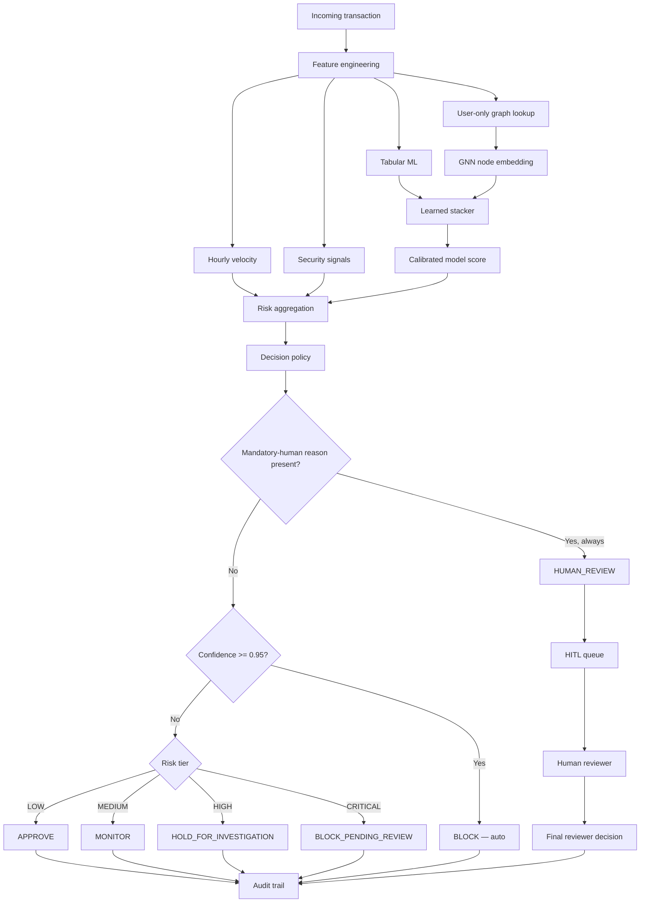

### System structure — how components connect and complement each other

This is the structural view: the frontend and API are the entry points, transaction state feeds stateful features, the graph supplies relational context, the ML models generate complementary evidence, policy combines those signals, and investigation/HITL handle cases that should not be decided by a model alone.

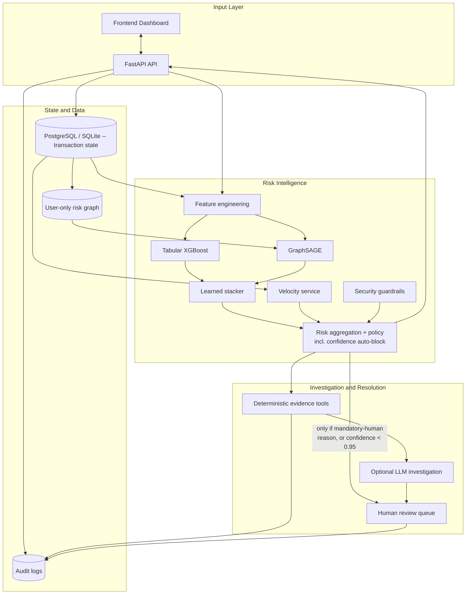

The editable Mermaid source for these diagrams is also stored under `docs/diagrams/`, including `transaction-flow.mmd`, `system-structure.mmd`, `training-evaluation.mmd`, and `live-inference.mmd`.

### Diagram format

All architecture/process diagrams in this README are rendered as **Mermaid** fenced blocks; there are no ASCII architecture diagrams. The editable `.mmd` sources are kept under `docs/diagrams/`. Screenshots in the demo section are UI evidence, not architecture diagrams.

| Diagram | README section | Source |
| --- | --- | --- |
| Conventional fraud baseline | Why RazorRisk? | Mermaid in README |
| Relational fraud context | Why RazorRisk? | Mermaid in README |
| Layered risk architecture | Why RazorRisk? | Mermaid in README |
| Model training/evaluation | Model training and evaluation pipeline | `docs/diagrams/training-evaluation.mmd` |
| Live transaction pipeline | Live transaction pipeline | `docs/diagrams/live-inference.mmd` |
| End-to-end workflow | End-to-end workflow | Mermaid in README |
| Transaction signal flow | Transaction flow | `docs/diagrams/transaction-flow.mmd` |
| System structure | System structure | `docs/diagrams/system-structure.mmd` |
| Causal graph update | Causal graph update | Mermaid in README |
| Final production validation | Final Production Validation | Mermaid in README |
| Distributed runtime | Production Distributed Runtime | Mermaid in README |
| PostgreSQL/Supabase data plane | Production Data Plane | Mermaid in README |

### Causal graph update

The current transaction is deliberately **not allowed to influence its own GNN score**.

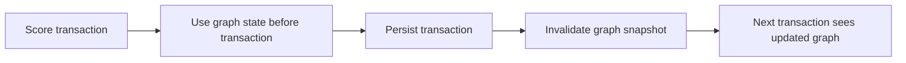

This avoids a subtle form of self-contamination while still allowing the graph to evolve transaction by transaction.

---

## Why the architecture is stronger than a single fraud model

The project deliberately separates responsibilities into distinct layers:

| Layer | Responsibility |
| --- | --- |
| **Tabular ML** | Transaction-level behavioral patterns |
| **GNN** | Relational/community context |
| **Stacker** | Learned combination of model evidence |
| **Policy + guardrails** | Operational decision and escalation |
| **HITL** | Human resolution for ambiguous/high-impact cases |
| **Investigation agent** | Evidence gathering and explanation |
| **Audit layer** | Traceability and post-decision review |

This makes the system easier to debug and defend than a single model that directly returns `fraud=true/false`.

---

## Evaluation

RazorRisk uses **one synthetic dataset as the source of truth for model training and evaluation**. Both ML branches see the same underlying transaction population and the same user-level train/test partition, but consume complementary representations:

- **XGBoost:** transaction-level behavioral features such as amount, velocity, amount deviation, merchant history, device diversity, and merchant diversity.
- **GraphSAGE / GNN:** the User-only risk graph derived from shared device/IP relationships and graph-derived node features.
- **Learned stacker:** combines paired XGBoost and GNN predictions for the same held-out transactions plus normalized shared-device/shared-IP evidence.

The public ULB/Kaggle `creditcard.csv` dataset is **not part of the RazorRisk model pipeline**. Its anonymized PCA feature space and absence of User/Device/IP/Merchant identities do not match the project's domain, so it is not used to train, evaluate, or drive the live RazorRisk models.

### Latest reproducible synthetic run

The shipped model artifacts were evaluated against a held-out pool of **9,218 transactions (78 fraud)**, reproducible with the command below. The underlying dataset is regenerated with `data/generate_synthetic_data.py` (a single generation run seeds ~3,044 transactions / 750 users), and the dashboard's "Reseed synthetic data" control can add more on top before evaluation runs. The fraud count in the held-out split (78) stays stable across reruns because it is tied to the same held-out users, which is what the numbers below depend on.

The generator intentionally targets **coverage**, not raw row count. It contains graph-driven fraud rings, fraud that is visible from transaction behavior alone, and hard benign look-alikes. This lets the two base models fail in different ways and gives the stacker a meaningful complementary signal to learn.

| Synthetic coverage family | Examples | Primary evidence |
| --- | --- | --- |
| Graph-driven fraud | device-sharing rings, shared-IP proxy rings, merchant collusion, device-cycling structuring, fan-out laundering | GNN + tabular |
| Transaction-only / obvious fraud | large round-number cash-out, odd-hour high-value fraud, risky-merchant activity, repeated authorization/card testing, non-round behavioral anomalies | XGBoost |
| Low-observability fraud | no-shared-infrastructure fraud, low-and-slow fraud, cold-start fraud, account takeover | complementary ML signals |
| Benign hard negatives | family/hostel sharing, carrier NAT, conference/event spikes, shared office/POS devices, bill splitting, recurring payments, legitimate fan-out shopping, popular merchants, cold-start benign users, high-value legitimate purchases | prevent single-rule shortcuts |

| Model | ROC-AUC | PR-AUC | Accuracy | Balanced Accuracy | Precision | Recall | F1 |
| --- | --- | --- | --- | --- | --- | --- | --- |
| Tabular / XGBoost | 0.998127 | 0.955096 | 0.996312 | 0.972718 | 0.711538 | **0.948718** | 0.813187 |
| GraphSAGE / GNN | 0.995925 | 0.888078 | 0.986548 | 0.942372 | 0.376344 | 0.897436 | 0.530303 |
| **Learned stacker** | **0.998393** | **0.956066** | **0.997396** | **0.973265** | **0.787234** | **0.948718** | **0.860465** |

Reproduce with: `python tests/evaluate_models.py --dataset synthetic` (uses the shipped artifacts) or add `--retrain` to retrain first. Every number above was verified by re-running that exact command against the shipped artifacts, not copied from a prior report. See [Bug #29 in BUGS.md](BUGS.md#bug-29--live-scorings-time-of-day-features-used-real-wall-clock-time-instead-of-the-transactions-own-timestamp) for why that check matters here.

### Understanding these metrics

Seven numbers per model is a lot to take at face value, so here is what each one is actually answering for this specific problem: a rare-event classifier where missing real fraud and wrongly blocking real customers cost different things.

| Metric | What it answers | Why it matters here | Its blind spot |
| --- | --- | --- | --- |
| **Precision** | "Of the transactions this model flagged as fraud, how many actually were?" | Low precision means real customers get blocked or held for nothing — a direct experience/trust cost. | Says nothing about fraud the model *missed* entirely. |
| **Recall** | "Of the transactions that actually were fraud, how many did this model catch?" | Missed fraud is the cost the whole system exists to prevent — undetected fraud is a direct loss. | Recall alone is trivially maximized by flagging everything — meaningless without precision alongside it. |
| **F1** | A single number balancing precision and recall (their harmonic mean). | Useful for ranking models when neither false positives nor false negatives is obviously more important. | Hides *which* of precision or recall is weak — two very differently-shaped models can share one F1. |
| **ROC-AUC** | "If you picked one random fraud case and one random legitimate case, how often would the model score the fraud case higher?" | A threshold-independent view of separability — useful for comparing models before committing to an operating point. | With fraud this rare (78 of 9,218, under 1%), ROC-AUC stays high almost by default, because it is dominated by the huge non-fraud majority the model gets right almost for free. |
| **PR-AUC** | Same idea as ROC-AUC, but plotted on precision vs. recall — much less forgiving when the positive class is rare. | A far more honest single number for this kind of imbalance than ROC-AUC. This is why PR-AUC is the primary ranking metric internally. | Still a single-number summary; it can't tell you the model's behavior *at the threshold the policy layer actually uses*. |
| **Accuracy** | "What fraction of all predictions were correct?" | Reported for completeness. | Actively misleading on a 99%-benign dataset — a model that never flags anything would still score ~99% accuracy. Not trusted alone anywhere in this project. |
| **Balanced accuracy** | Accuracy, but averaged per class instead of per transaction, so the rare fraud class counts as much as the common benign class. | Fixes accuracy's imbalance blind spot without needing a probability threshold. | Still a single blended number — doesn't say whether errors lean toward missed fraud or false alarms. |

The practical takeaway: **accuracy and ROC-AUC look great for almost any model on a dataset this imbalanced, so they are reported for completeness but not used to make decisions.** Precision, recall, and PR-AUC, computed directly from the confusion matrix and not smoothed by the 99% of transactions that are easy to get right, are what actually distinguish these three models from each other and what the decision policy's thresholds (see [End-to-end workflow](#end-to-end-workflow)) are tuned against.

### Stacker effect

The stacker is trained on paired predictions from the same synthetic transaction population. Because fraud is rare, the stacker uses **`class_weight="balanced"`**, so the minority fraud class receives inverse-frequency weight rather than letting the majority class dominate the logistic objective. The base models are also class-aware: XGBoost uses `scale_pos_weight`, while GraphSAGE uses a positive-class loss weight.

In this reproducible run, the stacker is **best or tied-best on every metric in the table above**. It isn't simply averaging the two base models' outputs; it is correcting for where each one is weakest (the GNN's precision most of all: GNN alone throws 116 false positives against the stacker's 20, at matched recall). Final confusion matrix: **74 TP / 20 FP / 4 FN / 9,120 TN**.

The learned stacker coefficients for this run were:

| Input | Coefficient |
| --- | --- |
| Tabular (XGBoost) probability | **6.6455** |
| GNN probability | **3.0112** |
| Shared-IP signal | **0.2922** |
| Shared-device signal | **0.1768** |
| Intercept | **-4.6001** |

The coefficients are learned from the training population via cross-validated regularization strength (see [Hyperparameter Selection](#hyperparameter-selection-cv) below); the system does not use a hand-picked weighted average.

**What the aggregate table doesn't show.** Aggregate metrics are computed over the whole held-out pool, which is dominated by easy cases, so they don't guarantee that every individual hard scenario clears the operating threshold the live policy actually uses. The golden fraud-scenario matrix is therefore a separate **blocking regression suite**. In the current deterministic test bootstrap, `USER_RING1_1` (device-sharing ring) is required to reach HIGH/CRITICAL, while `USER_RING2_1` (shared-IP proxy ring) is required to reach MEDIUM or higher. These are the documented bars in `tests/test_edge_case_matrix.py`, and the latest full regression suite passes.

The earlier LOW outcomes that triggered Bug #39 were caused by evaluating a fresh deterministic fixture against stale/incompatible model artifacts, not by weakening these scenario assertions. The original timestamp-related nondeterminism is documented separately as Bug #40. Even so, these coefficients are sensitive to exactly which synthetic run trained them, so the metrics are best quoted as a snapshot of this run rather than a permanent property of the architecture.

### Expanded synthetic scenario coverage

The generator includes both graph-driven and transaction-only cases:

- **Fraud:** device-sharing ring, shared-IP proxy ring, carding/micro-transactions, merchant collusion, device-cycling structuring, sub-threshold structuring, fan-out laundering, no-shared-infrastructure fraud, low-and-slow fraud, cold-start fraud, account takeover, and **tabular-only obvious behavioral fraud** (large/round/odd-hour/risky-merchant patterns).
- **Benign hard negatives:** family/hostel sharing, carrier NAT, conference/event spikes, shared office/POS devices, bill splitting, recurring payments, legitimate fan-out shopping, popular merchants, cold-start benign users, and **high-value legitimate purchases**.

The objective is not merely to increase row count. The additional cases create counterexamples where a single signal is insufficient, so the XGBoost and GNN branches learn complementary failure modes. Want more coverage? The generator (`data/generate_synthetic_data.py`) is parameterized by scenario family, so adding a new benign hard-negative or a new fraud pattern is a self-contained addition, not a rewrite.

---

## Hyperparameter Selection (CV)

The model configuration is selected with leakage-aware cross-validation rather than manual guessing.

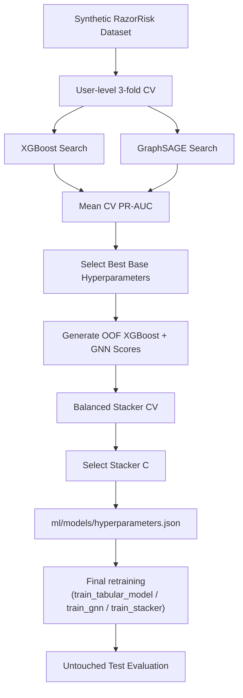

Run the search from the repository root:

```bash
python ml/hyperparameter_search.py
```

Or open `notebooks/hyperparameter_search.ipynb`.

### Selected configuration

| Component | Selected hyperparameters |
| --- | --- |
| XGBoost | `n_estimators=450`, `max_depth=4`, `learning_rate=0.025`, `min_child_weight=4`, `gamma=0.05`, `reg_lambda=3.0`, `subsample=0.9`, `colsample_bytree=0.85` |
| GraphSAGE | `hidden_dim_1=16`, `hidden_dim_2=8`, `learning_rate=0.03`, `epochs=350` |
| Stacker | `LogisticRegression(C=0.05, class_weight="balanced")` |

Selection metric: **mean 3-fold CV PR-AUC**. The stacker search considers balanced class weighting only, so class imbalance is explicitly handled rather than selected away by validation accuracy.

The complete search output is persisted in `ml/models/hyperparameters.json` and is **actually consumed** by `train_tabular_model()`, `train_gnn()`, and `train_stacker()` via `ml/common.py::load_tuned_hyperparameters()`. This used to be a one-way write, with the training pipeline hardcoding its own disconnected copy of the values (Bug #28), so re-running the search now genuinely changes what the next retrain produces instead of requiring a manual edit in three files.

For the non-determinism bug that this evaluation process almost shipped numbers from, see [Bug #29 in BUGS.md](BUGS.md). The reproducibility fixes that followed are Bugs #39–40.

---

## Current model/data contract

The production/demo contract is intentionally simple:

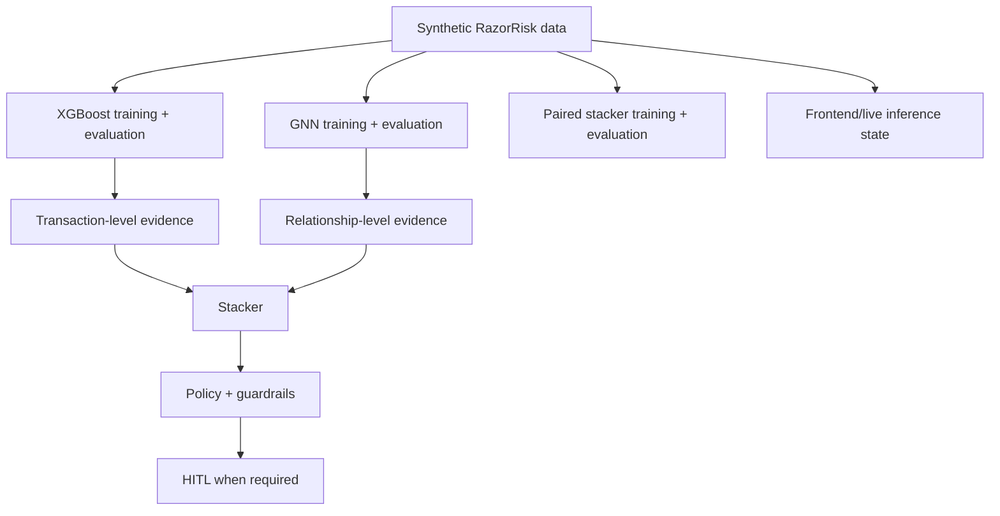

The public ULB/Kaggle `creditcard.csv` remains documented only as a **rejected external-data experiment**. Its PCA-only feature space is useful for studying a generic tabular fraud classifier, but it is not a faithful representation of RazorRisk's User/Device/IP/Merchant payment domain. Keeping it outside the current model contract avoids mixing incompatible feature semantics and evaluation populations.